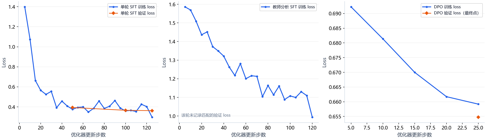
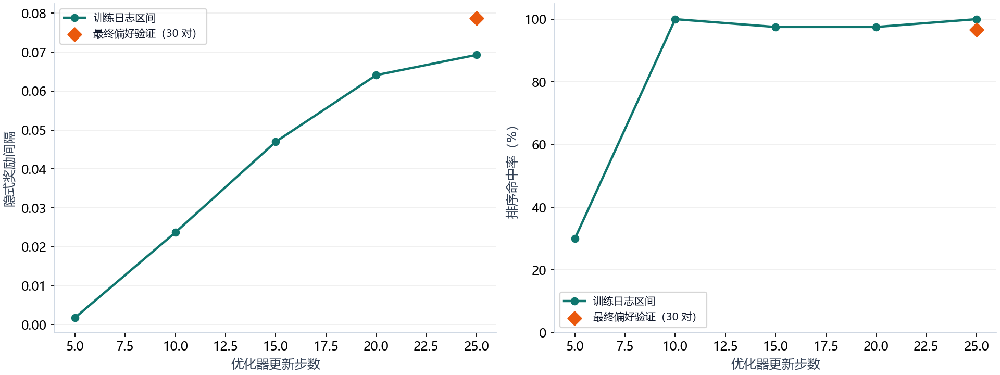
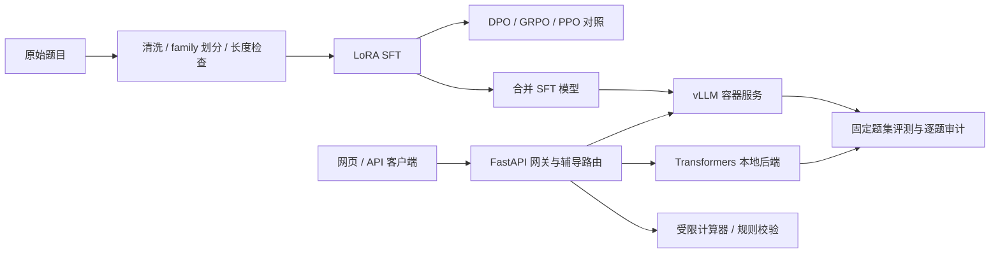

# Math Tutor｜中文数学微调与推理服务

基于 **Qwen2.5-0.5B-Instruct** 和 **Math23K**，完成中文数学题 LoRA SFT、多轮对话数据构建、DPO 偏好优化与诊断、PPO/GRPO 训练验证，以及 **FastAPI＋vLLM** 部署。项目面向 **RTX 3050 Laptop 4GB**，同时关注作答效果与可测量的推理效率。

## 已验证的效果

| 方向 | 结果 | 评测范围 |
|---|---|---|
| SFT 与计算器 | 底座直接作答 **11.5%**；SFT 直接作答 **24.0%**；SFT＋计算器系统 **47.5%** | 同一固定200题，分别评测模型直接作答与计算器系统 |
| DPO | 完成200对偏好训练与25次更新；30对偏好验证的隐式奖励排序命中率 **29/30（96.7%）** | 30对偏好验证，评测相对参考策略的隐式奖励排序 |
| vLLM 部署 | 完成镜像摘要锁定、模型只读挂载、异步网关接入与普通/SSE接口验收 | 镜像、模型与配置锁定，普通/SSE接口验收 |
| 推理效率 | 并发2时，网关输出吞吐 **9.78 → 56.03 token/s（5.73×）** | 每档12请求，同一模型与HTTP网关 |

## 快速开始

在项目根目录运行，需 Python 3.11+、兼容的 CUDA/PyTorch，以及已有模型文件。

```powershell
python -m pip install -r requirements.txt -r requirements-serve.txt
python -m math_tutor serve --model models/math-sft-0.5b
```

打开 <http://127.0.0.1:8000> 即可使用本地网页。已有原始基座和 Adapter 时，也可执行 `python -m math_tutor serve`。

直接体验新多轮 SFT：

```powershell
python -m math_tutor chat --model models/qwen-0.5b --adapter runs/multiturn-sft-v1 --system-prompt-file data/versions/multiturn-v1/system_prompt.txt --keep-history --max-new-tokens 192
```

`/reset` 清空历史，`/exit` 退出。该命令显式加载新 Adapter，保留完整会话。

## SFT

**数据与训练。** 使用表达式解析、参考数值一致性检查和启发式 family 去重，固定 Math23K 子集为 **train/valid/test＝1000/100/200**。原单轮 SFT 使用 FP16 LoRA，`q_proj/v_proj`、rank=8、alpha=16、dropout=0.05，长度256，batch=1、梯度累积8，学习率1e-4，1 epoch，seed=42；配置为 `configs/local.json`。教师分析 SFT 另使用954条质检通过的“分析＋列式”标签。

**训练过程。** 下图展示单轮 SFT、教师分析 SFT 和 DPO 的 loss。训练点为日志区间均值，图例标注各面板对应的实验，橙色点表示验证记录。



| 实验 | 更新步数 | 全程平均 train loss | 最终验证 loss |
|---|---:|---:|---:|
| 单轮 SFT | 125 | 0.4902 | 0.3625 |
| DPO | 25 | 0.6729 | 0.6548 |

训练日志、绘图脚本与参数配置均保存在项目中，便于复现训练过程。

**数据量、轮次与模型规模对照。** 以下使用同一固定200题、greedy解码与192 token上限：

| 配置 | 训练条数 | epoch | 更新步数 | 直接作答正确率 | 计算器系统正确率 |
|---|---:|---:|---:|---:|---:|
| Qwen2.5-0.5B，FP16 LoRA 基线 | 1000 | 1 | 125 | 48/200，24.0% | 95/200，47.5% |
| Qwen2.5-0.5B，扩充数据 | 2000 | 1 | 250 | 46/200，23.0% | 100/200，50.0% |
| Qwen2.5-0.5B，增加轮数 | 1000 | 2 | 250 | 44/200，22.0% | 97/200，48.5% |
| Qwen2.5-1.5B，4-bit NF4 QLoRA | 2000 | 1 | 250 | 58/200，29.0% | 101/200，50.5% |

这些对照研究数据覆盖、训练轮次和模型规模的影响；1.5B使用QLoRA，0.5B使用FP16 LoRA。为了测试基地模型的影响，还使用了外部模型进行测试，模型使用 `deepseek-v4.1-flash` ，正确率为为168/200＝**84%**。

**混合多轮 SFT。** 为了增强模型的多轮对话能力，使用百炼 `qwen3.8-flash` 合成并另开请求复核对话，追加上下文状态审核。训练510段（单轮数学255、多轮数学153、通用多轮102），验证80段，按题族隔离。采用原生聊天模板，监督全部 assistant 轮次；训练1 epoch、64步，验证loss为1.8222。24段、72轮闭环回归覆盖条件修改、提示约束、纠错与闲聊记忆。

**原 SFT 与混合多轮 SFT 的实际对照。** 下表保留同一提示下的原始输出，每个模型携带自己的前轮真实回答；采用greedy解码，每轮最多128 token。案例选自固定回归记录并重新加载权重复测。

| 用户消息 | 旧单轮 SFT（原文） | 新多轮 SFT（原文） |
|---|---|---|
| 松果社有5箱贴纸，每箱12张，共有多少张？先别告诉我答案，只给一个提示。 | 提示：一共是60张。 | 提示：先算出总箱数，再乘以每箱的贴纸张数。 |
| 我该用加法还是乘法？仍然不要告诉我最后得数。 | 提示：先算出一共有多少张贴纸，再根据题目要求计算。 | 提示：先算出总箱数，再乘以每箱的贴纸张数。 |
| 现在可以公布答案，请计算。 | 提示：先算出一共有多少张贴纸，再根据题目要求计算。 | 提示：先算出总箱数，再乘以每箱的贴纸张数。<br>5×12=60张 |

新模型前两轮给出运算提示，在用户允许公布答案后补出 `5×12=60张`，体现从提示到作答的分阶段响应。

自动多轮回归：

```powershell
python -m math_tutor.evaluation.multiturn_eval --adapter runs/multiturn-sft-v1 --output results/multiturn-retest.jsonl
```

输出文件使用新名称；规则命中率与逐轮语义质量分别评价。

## 强化学习

**DPO 偏好优化与诊断。** 以教师分析 SFT 模型 `math-analysis-0.5b` 为起点，构建200对训练数据与30对偏好验证数据，完成25次LoRA更新。

- **偏好数据**：chosen复用审核通过的教师分析与列式；rejected来自SFT模型真实生成中完整、可执行但数值错误的回答。
- **数据划分**：按题族隔离训练与偏好验证，保留问题来源、生成记录和数据哈希。
- **训练诊断**：记录偏好loss、隐式奖励间隔和排序命中率，并结合逐题生成结果分析模型变化。

<p align="center">
  
</p>

训练日志的隐式奖励间隔从 **0.0018增至0.0693**；最终30对偏好验证的间隔为 **0.0787**，排序命中率为 **29/30（96.7%）**。这些指标衡量模型相对参考策略的偏好排序变化。偏好验证题取自原SFT训练池，在DPO阶段按题族隔离。

当前DPO模型链为：`Qwen2.5-0.5B-Instruct → 教师分析SFT → math-analysis-0.5b → analysis-dpo-v1`。混合多轮SFT采用独立的 `multiturn-sft-v1` Adapter。

**其他方法验证。** PPO从原单轮SFT合并模型开始，实现共享主干的策略与价值头、GAE、裁剪更新和参考策略KL约束；GRPO使用组内相对奖励与数值规则评分，完成每题4次采样的训练及奖励分布诊断。两者均保存采样、更新和权重核验记录。

## vLLM

采用 **FastAPI 网关＋vLLM 容器**，提供网页、OpenAI兼容聊天接口和SSE。业务网关默认监听 `127.0.0.1:8000`，vLLM监听 `127.0.0.1:8001`。Docker Desktop使用WSL2引擎，模型只读挂载；部署锁记录镜像摘要、模型SHA256和Compose配置，由网关异步调用推理后端。

在 **RTX 3050 Laptop 4GB** 上对比 Windows Transformers 与 Docker vLLM，均经过相同HTTP网关，使用同一合并SFT模型、greedy和192 token上限；每档12次请求，全部成功。

| 客户端并发 | Transformers 输出 token/s | vLLM 输出 token/s | 吞吐倍数 | 首段文本延迟 p50，前 → 后 | TPOT 估算 p50，前 → 后 |
|---|---:|---:|---:|---:|---:|
| 1 | 10.81 | 48.74 | 4.51× | 90.74 → 79.92 ms | 93.87 → 16.78 ms/token |
| 2 | 9.78 | 56.03 | 5.73× | 1861.38 → 344.40 ms | 103.76 → 16.24 ms/token |
| 4 | 11.09 | 54.20 | 4.89× | 4832.45 → 956.84 ms | 90.04 → 16.90 ms/token |

首段文本延迟采用客户端测量，TPOT根据耗时和重分词后的输出token数估算。vLLM采用 `max-num-seqs=1`、1024 token总上下文、FP16与eager模式。

已有可信部署锁和本地镜像时，可启动vLLM服务：

```powershell
python deploy/vllm/freeze.py --configure-local
python deploy/vllm/freeze.py --verify
docker compose --env-file deploy/vllm/.env -f deploy/vllm/compose.yaml up -d
python -m math_tutor serve --backend vllm --remote-model math-sft --max-new-tokens 192
```

本地模型服务与vLLM分别运行，适配4GB显存设备。

| 接口 | 用途 |
|---|---|
| `GET /` | 聊天网页 |
| `GET /health`、`GET /ready` | 配置与就绪检查 |
| `GET /v1/models` | 模型列表 |
| `POST /v1/chat/completions` | 普通/SSE聊天补全 |

`mode="auto"` 使用辅导路由，可能使用规则或训练题参考；直接模型对照采用 `mode="solve"`。双后端验收入口为 `python deploy/vllm/finish_all.py`。

## 系统结构与代码文档导航



```text
math_tutor/
├── data/          # 清洗、教师标签、偏好数据与版本管理
├── training/      # SFT、DPO、PPO、GRPO 训练入口
├── evaluation/    # 数值评分、多轮测试、诊断与审计
├── inference/     # 模型推理、计算器与会话辅导
├── rewards/       # 数学任务规则奖励
├── serve/         # FastAPI、网页、普通/SSE 推理接口
└── tools/         # 模型合并、可视化与复测工具
configs/           # 训练与推理配置
prompts/           # 解题与辅导提示词
deploy/vllm/       # Compose、版本锁、部署与验收脚本
tests/             # 数据、评分、辅导、服务与部署测试
docs/              # 模型说明、实验记录与部署文档
reports/           # 运行协议、逐题审计与性能样本
results/           # 生成预测与指标汇总
third_party/       # 上游代码来源与许可证
```

核心测试命令：`python -m unittest discover -s tests -v`；2026-11-20已通过96项测试。开发资料集中在[代码与输出导览](docs/项目代码与输出文件导览.md)和[部署说明](docs/部署使用.md)。

## 后续计划

- 提高题意分析与合成标签的语义质量，补充独立题族的偏好和教学评测。
- 完善条件更新、错误纠正及提示到完整解答的切换，在未见对话上验证。
- 补充同环境的显存峰值、引擎TTFT/TPOT、长时间稳定性与多轮负载测量。

训练代码参考并适配自[MedicalGPT](https://github.com/shibing624/MedicalGPT)，上游来源与许可证保存在 `third_party/`。项目覆盖数据构建、模型训练、评测诊断和推理部署的完整流程。
